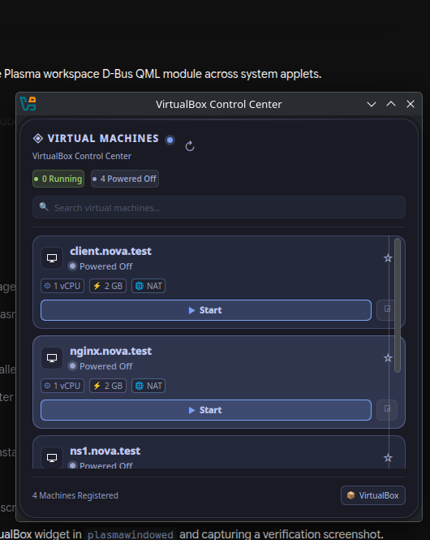
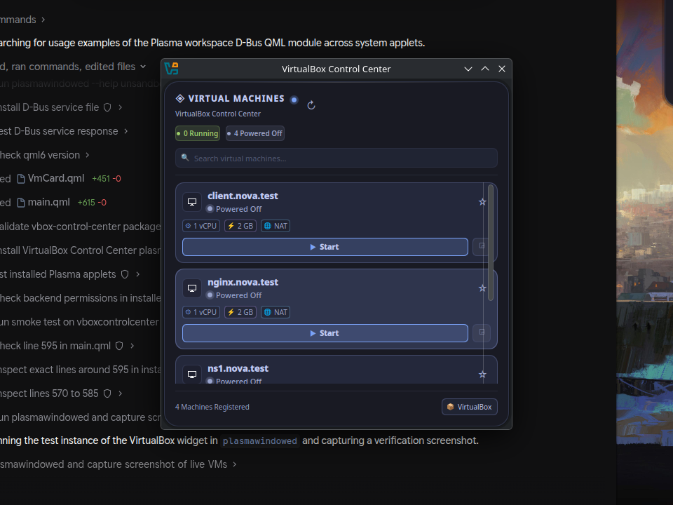

<div align="center">

# VirtualBox Control Center for KDE Plasma 6

[](https://kde.org)
[](https://wayland.freedesktop.org/)
[](https://www.virtualbox.org/)
[](https://www.python.org/)
[](LICENSE)
[](https://github.com/folke/tokyonight.nvim)

**A macOS-inspired floating VirtualBox management widget for KDE Plasma 6 desktops.**  
Styled with the iconic **Tokyo Night** aesthetic, featuring real-time VM monitoring, one-click controls, and zero shell injection vulnerabilities.

<br />



<br />

</div>

---

## 🌟 Highlights

- **Desktop-Native Floating Dashboard**: Designed as an Apple-style floating desktop card (`~360px` wide, `20px` corner radius, frosted dark glass `#1A1B26`).
- **Real-Time Machine Discovery**: Automatically discovers every VM registered in Oracle VirtualBox using `VBoxManage` UUIDs (no hardcoded names).
- **Interactive Lifecycle Controls**:
  - 🚀 **Start VM**: Launch in standard Graphical mode or Headless mode.
  - 🖥 **Console**: Focus or open the running VM window directly from your desktop.
  - ⏸ **Pause / Resume**: Freeze or resume VM execution on the fly.
  - 💾 **Save State**: Safely suspend VM state to disk.
  - 🔌 **ACPI Graceful Shutdown**: Trigger OS-level graceful power down with guest notification.
  - 📦 **Open Manager**: Instant shortcut to launch the full VirtualBox GUI.
- **Tokyo Night State Badges**:
  - `● Running` (`#9ECE6A` Emerald)
  - `● Paused` (`#E0AF68` Amber)
  - `○ Powered Off` (`#9AA5CE` Slate)
  - `● Saved` (`#BB9AF7` Purple)
  - `● Aborted / Error` (`#F7768E` Red)
- **Live Search & Spec Badges**: Filter virtual machines dynamically by name or guest OS type. Displays allocated vCPUs, RAM, and network mode (NAT, Bridged, Host-Only).
- **Pin to Favorites**: Click the star (`★`) on any machine card to keep critical servers pinned at the top.

---

## 📸 Screenshots

| Idle State (All Powered Off / Aborted) | Real-time Search & Filtering |
|:---:|:---:|
|  |  |

---

## 🏗 Architecture & Security

VirtualBox Control Center is designed from the ground up for desktop stability and enterprise security. The UI runs inside KDE Plasma's QML engine, communicating asynchronously with a user-level D-Bus daemon.

```text
┌────────────────────────────────────────────────────────┐
│  KDE Plasma 6 Desktop Applet (QML Frontend)            │
│  - macOS floating card geometry (~360px wide, 20px R)  │
│  - Live search filter, sort order, and status counters │
│  - PlasmoidItem (NoBackground, custom Tokyo Night)     │
└───────────────────────────┬────────────────────────────┘
                            │  D-Bus (org.kde.plasma.vboxcontrolcenter)
                            ▼
┌────────────────────────────────────────────────────────┐
│  VirtualBox Control Center Backend (Python 3)          │
│  - Auto-activated on demand by dbus-broker             │
│  - Strict UUID regex verification: ^[0-9a-fA-F-]{36}$  │
│  - Asynchronous background worker threads              │
│  - Non-blocking: desktop never stutters during VM boot │
│  - Zero shell interpolation (execve token arrays)      │
│  - Prevents duplicate operations on busy machines      │
└───────────────────────────┬────────────────────────────┘
                            │  Direct Subprocess (No Shell)
                            ▼
┌────────────────────────────────────────────────────────┐
│  Oracle VirtualBox Engine (VBoxManage 7.x)             │
│  - list vms / list runningvms                          │
│  - showvminfo <UUID> --machinereadable                 │
│  - startvm, controlvm (pause, resume, savestate, acpi) │
└────────────────────────────────────────────────────────┘
```

### Safety Guarantees
1. **Zero Shell Interpolation**: All commands use explicit argument arrays (`["VBoxManage", "startvm", uuid, ...]`). No `bash -c` or shell concatenation is ever used, eliminating command injection risks.
2. **Lab VM Protection**: Destructive operations (hard power-off, disk deletion, snapshot rollbacks) are strictly prevented from single-click actions.
3. **Graceful ACPI Shutdown**: ACPI power-button signals are sent instead of hard termination, preventing filesystem corruption on running virtual machines.

---

## 📋 System Requirements

- **Operating System**: Linux (Fedora 39+, Arch Linux, Ubuntu 24.04+, openSUSE Tumbleweed/Leap)
- **Desktop Environment**: KDE Plasma 6.0 or newer (Wayland or X11)
- **VirtualBox**: Oracle VirtualBox 6.1 or 7.x (`VBoxManage` in PATH)
- **Python**: Python 3.10+ with `python3-dbus` and `python3-gobject`

### Install Dependencies

<details>
<summary><b>Fedora Linux</b></summary>

```bash
sudo dnf install plasma-workspace python3-dbus python3-gobject VirtualBox
```
</details>

<details>
<summary><b>Arch Linux</b></summary>

```bash
sudo pacman -S plasma-workspace python-dbus python-gobject virtualbox
```
</details>

<details>
<summary><b>Ubuntu / Debian (Plasma 6)</b></summary>

```bash
sudo apt install plasma-workspace python3-dbus python3-gi virtualbox
```
</details>

---

## 🚀 Quick Start (Automated Installation)

Clone the repository and run the automated installer:

```bash
git clone https://github.com/<your-username>/vbox-control-center.git
cd vbox-control-center
chmod +x install.sh
./install.sh
```

The installer will:
1. Verify system dependencies (`kpackagetool6`, `python3-dbus`, `VBoxManage`).
2. Install the Plasmoid into `~/.local/share/plasma/plasmoids/org.kde.plasma.vboxcontrolcenter/`.
3. Configure and register the D-Bus service file in `~/.local/share/dbus-1/services/`.
4. Reload `dbus-broker` to enable instant auto-activation.

### Adding to Desktop

1. Right-click any empty space on your desktop wallpaper.
2. Select **Add Widgets...** (or press `Meta+W`).
3. Search for **VirtualBox Control Center**.
4. Drag and drop the card onto your desktop!

---

## 🛠 Manual Installation

If you prefer installing manually without running the install script:

```bash
# 1. Install plasmoid via kpackagetool6
kpackagetool6 -t Plasma/Applet -i .

# 2. Register D-Bus auto-activation service
mkdir -p ~/.local/share/dbus-1/services
cat <<EOF > ~/.local/share/dbus-1/services/org.kde.plasma.vboxcontrolcenter.service
[D-BUS Service]
Name=org.kde.plasma.vboxcontrolcenter
Exec=/usr/bin/python3 $HOME/.local/share/plasma/plasmoids/org.kde.plasma.vboxcontrolcenter/contents/backend/vbox_service.py
EOF

# 3. Reload D-Bus broker
systemctl --user reload dbus-broker.service || systemctl --user reload dbus.service
```

---

## 🧪 Testing in Isolation

You can preview and test the widget in a standalone test window at any time without modifying your desktop layout:

```bash
plasmawindowed org.kde.plasma.vboxcontrolcenter
```

To run the backend test suite (UUID validation, parsing, state handling):

```bash
python3 contents/backend/test_vbox_service.py
```

Expected output:
```text
Ran 8 tests in 0.001s
OK
```

---

## ⚙️ Configuration Options

Right-click the widget on your desktop and select **Configure VirtualBox Control Center...** (or click the gear icon in the header):

| Setting | Default | Description |
|---|---|---|
| **Refresh Interval** | `8 seconds` | How often the widget queries VM states. |
| **Default Start Mode** | `Graphical (GUI)` | Choose whether the Start button launches VMs in standard GUI mode or headless background mode. |
| **Card Opacity** | `92%` | Translucency percentage of the floating card background. |
| **Sort Order** | `Favorites First` | Order machines by Favorites first, Alphabetical, or State. |

---

## 🗑 Uninstallation

To cleanly remove the widget and its D-Bus service:

```bash
./uninstall.sh
```

Or manually:
```bash
kpackagetool6 -t Plasma/Applet -r org.kde.plasma.vboxcontrolcenter
rm -f ~/.local/share/dbus-1/services/org.kde.plasma.vboxcontrolcenter.service
systemctl --user reload dbus-broker.service 2>/dev/null || true
```

---

## 🤝 Contributing

Contributions, feature suggestions, and bug reports are welcome! Please check out [CONTRIBUTING.md](CONTRIBUTING.md) for development setup and testing guidelines.

---

## 📄 License

This project is licensed under the [MIT License](LICENSE).
